

  

  

 

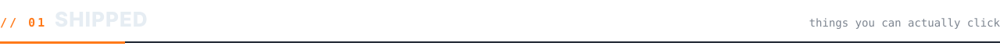

  <a href="https://zerochance1907.github.io/arm-playground/"></a>
  <a href="https://github.com/zerochance1907/agent-forge"></a>

  <a href="https://zerochance1907.github.io/paper-playground/"></a>
  <a href="https://github.com/zerochance1907/forgejury"></a>

  <a href="https://zerochance1907.github.io/emberwild/"></a>
  <a href="https://github.com/zerochance1907/skyharbor"></a>

 

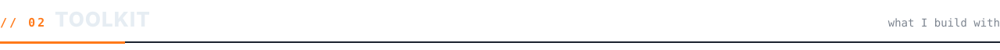

  
   
  

  <code>reinforcement learning</code> · <code>PPO</code> · <code>voice agents</code> · <code>Claude Code agents</code> · <code>multi-agent orchestration</code> · <code>browser 3D</code> · <code>AI automation</code>

 

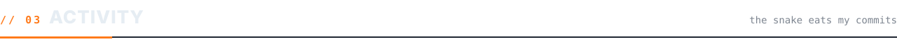

  <picture>
    <source media="(prefers-color-scheme: dark)" srcset="https://raw.githubusercontent.com/zerochance1907/zerochance1907/output/snake-dark.svg"/>
    <source media="(prefers-color-scheme: light)" srcset="https://raw.githubusercontent.com/zerochance1907/zerochance1907/output/snake.svg"/>
    
  </picture>

  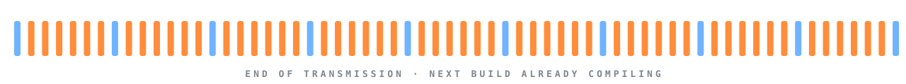

